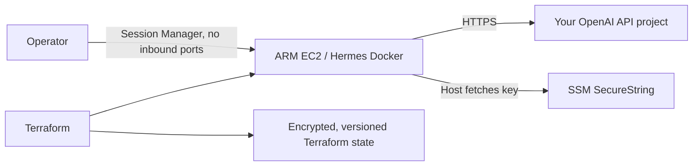

# Hermes on AWS, on demand

A small, forkable Terraform experiment for [Nous Research Hermes Agent](https://github.com/NousResearch/hermes-agent). Run the official Docker image on one ARM EC2 instance, use your own OpenAI API project, and remove the server when you finish. MIT licensed; no account credentials belong in this repository.

The first version provides an interactive CLI through AWS Session Manager. Telegram, Bedrock, GitHub, and delivery-orchestrator integration are future extensions.



## What you pay for

The default is `t4g.small` (2 GiB), Amazon Linux 2023, a 20 GiB encrypted gp3 root disk, and an automatically assigned public IPv4 address for outbound internet access. There is no NAT Gateway, load balancer, GPU, database, or inbound security-group rule. CPU credits use standard mode to avoid surplus-credit charges. ARM Docker images are supported by upstream Hermes.

This is a low-cost starting point, not a claim that EC2 is the cheapest possible AWS product. Estimate your regional EC2, EBS, IPv4, and transfer costs with the [AWS Pricing Calculator](https://calculator.aws/). [Public IPv4](https://aws.amazon.com/vpc/pricing/) is billed separately; [EC2 Linux on-demand](https://aws.amazon.com/ec2/pricing/on-demand/) is billed while running. OpenAI usage is separate. A 1 GiB `t4g.micro` may work with a reduced workload but has less memory headroom; browser-heavy work needs more RAM. Stopping EC2 retains billable storage; destroying the runtime removes it.

## Prerequisites

- An AWS Organizations member account, administrator access for provisioning, and an AWS CLI v2 login. Use a dedicated experimental member account, not the management account, for the server.
- Terraform 1.10 or later (CI uses 1.15.8), Python 3, and the [Session Manager plugin](https://docs.aws.amazon.com/systems-manager/latest/userguide/session-manager-working-with-install-plugin.html).
- An OpenAI API organization with billing and a dedicated project/service-account key. A ChatGPT subscription does not supply that API key.
- Docker locally only if you want to inspect or test the Hermes image.

## Fork and configure

Fork this repository and clone your fork. GitHub Actions runs formatting, Terraform validation, and script checks on pushes and pull requests without AWS credentials. No repository secrets or GitHub deployment roles are needed: this deliberately simple version provisions from your authenticated workstation.

### 1. Select or create a member account

If you already have a dedicated member account, skip `infra/account`. Otherwise, copy `infra/account/terraform.tfvars.example` to `terraform.tfvars` in that directory and fill in your management account ID and a unique account email. Authenticate to the management account and run:

```bash
export AWS_PROFILE=your-management-profile
aws sts get-caller-identity
terraform -chdir=infra/account init
terraform -chdir=infra/account plan
terraform -chdir=infra/account apply
```

This creates one account under your existing AWS Organization; it does not create an organization. The account and local state are durable. `prevent_destroy` prevents accidental account removal. Preserve that sensitive local state in a secure backup. For portal access, optionally set `portal_assignment` to your existing IAM Identity Center instance ARN, permission-set ARN, principal ID, and principal type (`USER` or `GROUP`) before applying. See the commented example in the variable file. Without an assignment, the new account will not appear in your SSO access portal. Alternatively, configure a CLI role profile for its `OrganizationAccountAccessRole` using an authorized management profile as the source. Switch to the member-account profile for every remaining step.

### 2. Create the state bucket once

Copy `infra/bootstrap/terraform.tfvars.example` to `infra/bootstrap/terraform.tfvars`, fill in the member account ID, region, and a globally unique bucket name, then run:

```bash
export AWS_PROFILE=your-member-account-profile
aws sts get-caller-identity
terraform -chdir=infra/bootstrap init
terraform -chdir=infra/bootstrap plan
terraform -chdir=infra/bootstrap apply
```

The bootstrap has local state; preserve it securely. The S3 bucket uses encryption, versioning, public-access blocking, TLS enforcement, and deletion protection. Runtime state is stored there with S3 native locking. Terraform providers refuse to operate against any account other than the ID you configured.

### 3. Create the OpenAI project and save its key

Create `hermes-experiment` in [OpenAI project settings](https://platform.openai.com/settings/organization/projects), create a project service account and API key, and configure the available model and spend controls for the project. Check whether your chosen control is a notification or an enforced limit. Project administration requires owner/admin authority; see the [official OpenAI Admin APIs documentation](https://developers.openai.com/api/docs/guides/admin-apis).

Save the key with a hidden local prompt:

```bash
python3 scripts/set-openai-key.py \
  --profile your-member-account-profile \
  --account-id YOUR_MEMBER_ACCOUNT_ID \
  --region us-east-1
```

This stores a Standard SSM SecureString encrypted by the AWS-managed SSM key. It verifies the caller's account and sends the secret through stdin. Terraform never reads or owns the secret value, and the runtime role can fetch only the exact configured parameter. Do not paste the key into chat, a shell command, `.tfvars`, GitHub secrets, or issues. The parameter survives runtime teardown. Changing `openai_key_parameter` requires saving your key at that alternate path using your own secure procedure.

### 4. Pin Hermes and provision

Review the current upstream stable release and obtain the multi-architecture image digest:

```bash
docker buildx imagetools inspect nousresearch/hermes-agent:stable
```

Use the top-level `Digest` with `nousresearch/hermes-agent@sha256:...`. Copy `infra/runtime/terraform.tfvars.example` to `infra/runtime/terraform.tfvars` and set the member account, region, image digest, and OpenAI model. For a modest first test, `gpt-4.1-mini` is a configurable example; confirm it is enabled in your project. See [model capabilities and pricing](https://developers.openai.com/api/docs/models/gpt-4.1-mini).

Copy `infra/runtime/backend.hcl.example` to `infra/runtime/backend.hcl` and use the bootstrap bucket and matching region. Then:

```bash
export AWS_PROFILE=your-member-account-profile
bash scripts/stack.sh init
bash scripts/stack.sh plan
bash scripts/stack.sh apply
bash scripts/stack.sh connect
```

Review Terraform's plan before confirming apply. Wait a few minutes for cloud-init, image downloads, and SSM registration. Inside the Session Manager shell:

```bash
sudo systemctl status hermes --no-pager
sudo docker exec -it hermes hermes chat
```

Ask a short question to verify OpenAI connectivity. The container stays idle between CLI sessions. The provider is explicitly `openai-api`, with the OpenAI endpoint, and there is no configured fallback provider. Hermes data is under `/srv/hermes` and mounted at `/opt/data`. The [official Docker guide](https://hermes-agent.nousresearch.com/docs/user-guide/docker) documents the runtime ownership and container commands; the [provider guide](https://hermes-agent.nousresearch.com/docs/integrations/providers) documents OpenAI and Bedrock.

### 5. Deprovision and reprovision

```bash
export AWS_PROFILE=your-member-account-profile
bash scripts/stack.sh destroy
# Later:
bash scripts/stack.sh apply
```

**Destroy deletes the instance, its disk, conversations, downloaded skills, and local configuration.** It also removes this runtime's VPC and IAM resources. Export any data you want to keep before confirming Terraform's destroy plan. The member account, state bucket, and SSM API-key parameter remain. A later apply fetches that retained key and starts a fresh Hermes data directory. S3 state storage/requests can still incur small charges. Full retirement also requires deleting the retained SSM parameter, revoking the OpenAI key, and separately handling the protected bucket/account.

Changing the image, model, or generated user data replaces the server and deletes its data. Treat those changes like teardown. An AMI update can also trigger replacement on a later plan.

## Troubleshooting and next steps

Check `sudo tail -n 50 /var/log/cloud-init-output.log` if Docker is missing, and `sudo journalctl -u hermes -n 30 --no-pager` if the service fails. A missing SSM key causes startup to retry every 30 seconds. An image architecture/pull error requires correcting the image pin. AWS administrator access is needed to connect unless you configure narrower operator permissions. Never share raw logs without reviewing them for private data.

See [future integrations](docs/future-integrations.md) for Telegram and Bedrock. See [SECURITY.md](SECURITY.md) for the experimental trust boundary. This template has not been production hardened; a successful Terraform apply does not prove the agent can complete a model request.

## Local CI checks

```bash
terraform fmt -check -recursive infra
for root in infra/account infra/bootstrap infra/runtime; do
  terraform -chdir="$root" init -backend=false -lockfile=readonly
  terraform -chdir="$root" validate
done
bash -n scripts/stack.sh
python3 -m py_compile scripts/set-openai-key.py
```

Commit provider lock files; never commit state, real variables, backend settings, secrets, or private exports.
